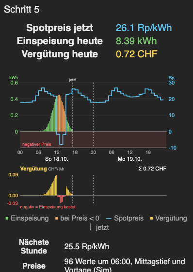

# Übungen – Arbeiten mit dem Coding-Agenten auf dem gPlug

📄 [Diese Übung als PDF (A4)](docs/EXERCISES.pdf) · [Begriffe: LEGENDE.md](LEGENDE.md)

Du übst den **Arbeitszyklus mit dem Agenten**: planen lassen → umsetzen lassen → Log lesen →
Fehler wörtlich zurückgeben → selbst prüfen. Die Berry-App `app/spot.be` ist nur das
Übungsobjekt. Von oben nach unten lesen; Schritte lassen sich auf- und zuklappen (▸).

## Farbcode: plan oder build

opencode hat zwei Agenten. Der aktive steht unten im Eingabefeld, **`Tab`** wechselt. Der
Gesprächsverlauf bleibt erhalten.

> [!NOTE]
> **🔵 PLAN** – Agent liest nur. Für den Prompt «planen».

> [!TIP]
> **🟢 BUILD** – Agent ändert Dateien und führt Befehle aus (nach Freigabe). Für «umsetzen» und
> «Fehler zurückgeben».

> [!WARNING]
> **⚠️ Stolperstein** – was hier typischerweise schiefgeht.

Merkregel: **planen = plan, alles andere = build.** opencode startet im **build**-Agent.

## Überblick: vom Starter zur Referenz-App in 4 Schritten, dazu Schritt 5

Vom **Starter** (nur Preislinie) zum Zielbild `docs/zielbild.jpg`. **Pflicht: Schritte 1 und 2.**
3 und 4 für Schnelle, 5 für Fortgeschrittene. Zeitbudget 45 min.

<details>
<summary>Alle Schritte im Überblick (Tabelle)</summary>

| Schritt | Ziel | Sichtbares Resultat | Lernziel KI |
|---|---|---|---|
| 0 Starter | – | Preislinie, 1 Tag, ¼ h | – |
| 1 Energie-Balken | Einspeisung pro ¼ h als grüne Balken, eigene kWh-Achse links | Solarkurve unter der Preislinie | Kontext geben: Erweiterungspunkt und Datenquelle nennen |
| 2 Negativpreis | Balken orange bei Preis < 0, Bereich unter 0 Rp. schattiert, Legende | Mittagstief fällt auf | Kleine, prüfbare Aufgabe; Testfall benennen (Sim: Mittagstief < 0) |
| 3 3 Tage, Stundenwerte | x-Achse 72 h, Tagesnamen, 00/12-Marken; Stunde = Mittel (Preis) bzw. Summe (Energie) | Do–Sa wie im Zielbild | Umbauen statt anbauen; Heap vorher/nachher messen |
| 4 Vergütungs-Chart | Zweites Chart darunter: CHF/h gelb/rot, Σ über 3 Tage | Zielbild komplett | Auf eigenem Ergebnis aufbauen; Wiederverwendung einfordern |
| 5 2 Tage, Viertelstunden | 192 ¼-h-Werte: gestern + heute, ab Preisen für morgen heute + morgen; Preis als Treppe | Preisspitzen innerhalb der Stunde sichtbar | Konstanten statt Zahlen; Kosten (Bytes, ms, Heap) messen lassen |

**Checkpoints**: `app/steps/spot_0.be` (Starter) … `spot_5.be` enthalten den fertigen Stand nach
jedem Schritt. Wer hängen bleibt, kopiert selbst den passenden nach `app/spot.be`.

</details>

<details>
<summary>Starter (Schritt 0): was schon da ist</summary>


Daten vollständig, Darstellung minimal:

- Im Hintergrund: Preisabruf (F1), Zähler mit Simulator inkl. Zeitraffer, `Po` und gefüllten
  Vortagen (F2), Tages-CSV (F4), `SpotPrices` (F5). Der Speicher hält **3 Tage** Preise und Energie.
- Textzeilen über dem Chart: Spotpreis jetzt, Einspeisung heute, Vergütung heute. Damit sind die
  Daten sichtbar, bevor sie gezeichnet werden; Schritt 1 lässt sich an «Einspeisung heute» prüfen.
- Chart: **nur die Preislinie** (cyan, `COL_PRICE`), 1 Tag mit 96 ¼-h-Werten, Achse Rp./kWh
  rechts, Nulllinie, «jetzt»-Marke (grau), Legende aus `chart_curves()`. Farben wie im Zielbild;
  `COL_ENERGY` (grün), `COL_NEG` (orange), `COL_PAY` (gelb), `COL_COST` (rot) sind schon definiert.
- Simulator gibt dem heutigen Tag ein Mittagstief mit negativen Preisen (Testfall Schritt 2).
- Vorhandene Helfer: `chart_curves()`, `send_polyline(...)`, `value_range(...)`, `nice_range(...)`
  (runde Achsenstufen), `y_scale(...)`, `send_data_attr(...)` (Werte für den Cursor),
  Farbkonstanten `COL_...`, Datenzugriff `self.store.price(key, slot)` (1/10'000 CHF/kWh) und
  `self.store.energy_at(key, slot)` (0.01 kWh), beide `nil` = Lücke.
- Kommentare `# ERWEITERUNGSPUNKT Schritt 1` … `Schritt 4` am Anfang von `F3  Chart`; jeder
  Checkpoint enthält nur noch die Punkte der offenen Schritte.
- Cursor-Script in allen Stufen gleich: es zeigt jeden vorhandenen Wert (`data-p`, `data-e`,
  `data-v`) und rechnet die Zeit aus `data-m` (15 oder 60 min). Kein Schritt ändert das Script.

</details>

## Vorbereitung (5 min)

1. Geräte-IP prüfen (RUNBOOK, Schritt 6.1): `cat .gplug`
2. Gerät antwortet mit `"Sim":true`. **`HeapFree` notieren** (Ausgangswert, z.B. 125).
   ```sh
   ./brcmd.sh 'tasmota.cmd("SpotStatus")'
   ```
3. WebUI des gPlug im Browser offen lassen (`http://192.168.x.y`).
4. opencode starten: `./docker-run.sh` (ohne Docker: `opencode` im Repo-Ordner).

## Schritt 1 – Energie-Balken (Pflicht, ~20 min)

**Ziel:** Die App zeigt neben dem Preis auch deine Einspeisung: grüne Balken (kWh pro
Viertelstunde) hinter der Preislinie, eigene Achse links.

<details open>
<summary><b>Schritt 1 – Anleitung</b> (zuklappen, wenn erledigt)</summary>


### 1.1 Planen lassen

> **🔵 PLAN** – `Tab`, bis unten `Plan` steht. Prompt einfügen.

```
Lies @AGENTS.md, @TASMOTA_BERRY_API.md und in @app/spot.be den Abschnitt "F3  Chart" mit dem
Kommentar "ERWEITERUNGSPUNKT Schritt 1".

Aufgabe: Im Tageschart soll die eingespeiste Energie pro Viertelstunde (kWh) als grüne Balken
hinter der Preislinie erscheinen.

Vorgaben: Datenquelle self.store.energy_at(key, slot) (0.01 kWh, nil = Lücke). Kurzbuchstabe e,
Farbe COL_ENERGY. Eine neue Achse links mit kWh von 0 bis Tagesmaximum (ausdrücklich erlaubt),
Preisachse rechts unverändert. Legendeneintrag "Einspeisung" mit &#9632;, ein-/ausblendbar.
Bestehende Helfer verwenden: chart_curves, value_range, y_scale. Kein JavaScript, nichts anderes
ändern.

Schreibe einen Plan: welche Methoden du änderst oder neu anlegst und wie du das Ergebnis prüfst
(Desktop-Harness, upload.sh, log.sh, Heap). Frag nach, wenn etwas unklar ist. Noch nichts ändern.
```

*Warum?* Einen falschen Ansatz im Plan zu erkennen kostet eine Minute, im Code einen Upload und
Rückbau.

> **⚠️ Plan ablehnen bei:** eigener Zeichenschleife ausserhalb `send_bars` · Checkboxen oder
> `<script>` (laufen in Tasmota nie) · weiteren Achsen · Funktionen, die nicht in
> `TASMOTA_BERRY_API.md` stehen · Änderungen ausserhalb der Aufgabe. Im plan-Agent bleiben,
> Vorgabe zitieren, neuen Plan verlangen.

### 1.2 Umsetzen lassen

> **🟢 BUILD** – `Tab`, bis unten `Build` steht. Prompt einfügen.

```
Setze den Plan um, in dieser Reihenfolge:
1. Änderung in app/spot.be.
2. cd app && berry desktop_harness.be – muss mit HARNESS OK enden.
3. ./upload.sh app/spot.be, danach ./log.sh. Jede Zeile mit BRY: oder SPOT: wörtlich zeigen.
4. ./brcmd.sh 'tasmota.gc()' und ./brcmd.sh 'tasmota.memory("heap_free")', Heap melden.
Melde in fünf Zeilen: was geändert, was geprüft, was offen. Die WebUI prüfe ich selbst.
```

Shell-Befehle einzeln freigeben, nur `./upload.sh`, `./log.sh`, `./brcmd.sh`, `berry`, `cp`, `git`.

*Warum?* Der Harness findet Syntaxfehler in Sekunden ohne Gerät; die feste Reihenfolge
verhindert übersprungene Prüfungen.

> **⚠️** Agent antwortet nur mit Text: noch plan aktiv, auf build schalten. Aufs Gerät gehört
> nur `app/spot.be`. Kein `BrRestart`/`Restart` über `brcmd.sh`.

### 1.3 Log lesen, Fehler zurückgeben

Ausgabe von `./log.sh` selbst lesen:

- **`BRY:`** – Berry konnte die App nicht laden oder ausführen (Syntax, strict mode), meist mit
  Zeilennummer.
- **`SPOT:`** – die App hat in einem Callback einen Fehler abgefangen (`SPOT: page_svg …`).
- Keines von beiden: App geladen, weiter bei 1.4.

> **🟢 BUILD** – nicht umschalten. Fehlerzeilen wörtlich zurückgeben.

```
./log.sh zeigt nach dem Upload:
<Zeilen wörtlich einfügen>
Behebe nur diesen Fehler, lade neu hoch und lies das Log erneut.
```

*Warum?* `upload.sh` meldet `OK`, sobald die Datei auf dem Gerät liegt; ob Berry sie laden
konnte, steht nur im Log. Aus der wörtlichen Meldung findet der Agent die Stelle, aus «geht
nicht» rät er.

> **⚠️** `BRY:`-Fehler direkt beim Laden: oft fehlendes `var` (strict mode). Zweimal derselbe
> Fehler: anhalten, Kursleitung fragen oder Checkpoint nehmen.

### 1.4 Resultat prüfen

```sh
./brcmd.sh 'tasmota.cmd("SpotStatus")'            # HeapFree nahe Ausgangswert
./brcmd.sh 'tasmota.gc()'; ./brcmd.sh 'tasmota.memory("heap_free")'   # > 100 kB
```

Browser: Seite **neu laden** (sonst fehlen Chart oder Cursor). Erwartet:

- Grüne Balken mit Tageskurve (Sim: Maximum um 12:40, Sockel 0.075 kWh/¼ h).
- Achse links in kWh, Preisachse rechts unverändert, Legende mit «Einspeisung».
- Summe der Balken ≈ «Einspeisung heute» in der Kopfzeile.

*Warum Heap?* Nur ~110 kB RAM frei. Jeder Upload kostet ~1 kB; fällt der Wert stärker, ist die
Änderung schuld.

> **⚠️ Das Resultat kann falsch sein, auch wenn alles «OK» meldet.** `HARNESS OK` und ein
> sauberes Log beweisen nur, dass der Code läuft, nicht, dass er richtig rechnet. Typisch:
> **falsche Skala** (Balken mit Preis-Skala gezeichnet und nur 1–2 Pixel hoch; Achse zeigt «30»
> statt «0.30» kWh; Balkenhöhe passt nicht zur Achse).
>
> **Selbst nachrechnen:** Höchster Balken = Zahl oben an der kWh-Achse? Sockel ≈ 0.075 kWh?
> Summe ≈ «Einspeisung heute»? Stimmt eine Zahl nicht: mit konkreten Werten zurück an den
> Agenten (🟢 BUILD).

### 1.5 Stand sichern

```sh
cp app/spot.be spot_schritt1.be      # oder: git add app/spot.be && git commit -m "Schritt 1"
```

*Warum?* Rückweg, wenn Schritt 2 schiefgeht, und Vergleich per `diff`.

Hängen geblieben? `cp app/steps/spot_1.be app/spot.be && ./upload.sh app/spot.be`

</details>

## Schritt 2 – Negativpreis hervorheben (Pflicht, ~15 min)

**Ziel:** Die App zeigt, wann Einspeisen Geld kostet: Balken orange bei Preis < 0, Bereich unter
0 Rp. schattiert.

<details open>
<summary><b>Schritt 2 – Anleitung</b> (zuklappen, wenn erledigt)</summary>


### 2.1 Planen lassen

> **🔵 PLAN** – zurück auf plan: `Tab`, bis unten `Plan` steht. Prompt einfügen.

```
Lies in @app/spot.be den Abschnitt "F3  Chart" mit dem Kommentar "ERWEITERUNGSPUNKT Schritt 2".

Aufgabe: Energie-Balken in Slots mit negativem Preis orange (COL_NEG) statt grün. Bereich unter
der Nulllinie halbtransparent schattieren mit Text "negativer Preis", nur wenn der Tag negative
Preise hat. Legendeneintrag "Einspeisung bei Preis < 0" in Orange.

Nichts anderes ändern. Nenne im Plan, wie du prüfst, dass orange Balken genau bei negativem
Preis erscheinen (der Simulator liefert heute ein Mittagstief < 0). Noch nichts ändern.
```

*Warum ein Testfall im Prompt?* «Orange genau dort, wo der Preis < 0 ist» kann der Agent
prüfen, «mach es orange» nicht.

> **⚠️ Plan ablehnen bei:** zweiter Balken-Methode statt Farbwahl in `send_bars` · Checkboxen,
> `<script>`, weiteren Achsen · Prüfung über `SpotPrices` (zeigt nur die nächsten 10 h).

### 2.2 Umsetzen lassen

> **🟢 BUILD** – `Tab`, bis unten `Build` steht. Gleicher Prompt wie in Schritt 1.

```
Setze den Plan um, in dieser Reihenfolge:
1. Änderung in app/spot.be.
2. cd app && berry desktop_harness.be – muss mit HARNESS OK enden.
3. ./upload.sh app/spot.be, danach ./log.sh. Jede Zeile mit BRY: oder SPOT: wörtlich zeigen.
4. ./brcmd.sh 'tasmota.gc()' und ./brcmd.sh 'tasmota.memory("heap_free")', Heap melden.
Melde in fünf Zeilen: was geändert, was geprüft, was offen. Die WebUI prüfe ich selbst.
```

*Warum derselbe Prompt?* Gleiche Meldung bei jedem Schritt: du siehst sofort, wenn eine Prüfung
fehlt.

> **⚠️ Scope-Creep** («bei der Gelegenheit habe ich auch …»): «nichts anderes ändern»
> wiederholen, mit `/undo` zurücknehmen.

### 2.3 Log lesen, Fehler zurückgeben

`./log.sh` lesen. Zeile mit `BRY:` oder `SPOT:`-Fehler:

> **🟢 BUILD** – nicht umschalten. Fehlerzeilen wörtlich zurückgeben.

```
./log.sh zeigt nach dem Upload:
<Zeilen wörtlich einfügen>
Behebe nur diesen Fehler, lade neu hoch und lies das Log erneut.
```

*Warum «nur diesen Fehler»?* Sonst baut der Agent bei der Fehlersuche weiteres um.

> **⚠️** Zweimal derselbe Fehler: `cp spot_schritt1.be app/spot.be`, neu planen.

### 2.4 Resultat prüfen

```sh
./brcmd.sh 'tasmota.cmd("SpotStatus")'            # HeapFree nahe Ausgangswert
./brcmd.sh 'tasmota.gc()'; ./brcmd.sh 'tasmota.memory("heap_free")'   # > 100 kB
diff spot_schritt1.be app/spot.be | head -40      # wenige Stellen (oder git diff --stat)
```

Browser: Seite **neu laden**. Erwartet:

- Orange Balken genau dort, wo die Preislinie unter 0 liegt (Sim: Mittagstief), sonst grün.
- Schattierung mit Text «negativer Preis» unter der Nulllinie, Legendeneintrag in Orange.
- Balkenhöhen wie nach Schritt 1.

*Warum der `diff`?* Er zeigt, was der Agent wirklich geändert hat, unabhängig von seiner Meldung.

### 2.5 Stand sichern

```sh
cp app/spot.be spot_schritt2.be      # oder: git add app/spot.be && git commit -m "Schritt 2"
```

Hängen geblieben? `cp app/steps/spot_2.be app/spot.be && ./upload.sh app/spot.be`

</details>

**Pflichtteil geschafft.** Ablauf ab jetzt: 🔵 planen → Plan prüfen → 🟢 umsetzen → Log lesen →
Heap und WebUI prüfen → sichern.

## Schritt 3 – 3 Tage mit Stundenwerten (für Schnelle, ~20 min)

**Ziel:** Die App zeigt den ganzen Speicher: 3 Tage nebeneinander mit Stundenwerten und
Tagesnamen («Do 11.06.»).

<details>
<summary><b>Schritt 3 – Anleitung aufklappen</b></summary>


> **🔵 PLAN** – Prompt einfügen. Plan prüfen: jede geänderte Methode aufgelistet, keine Kopien,
> Heap-Messung vorher/nachher.

```
Lies in @app/spot.be den Abschnitt "F3  Chart" mit dem Kommentar "ERWEITERUNGSPUNKT Schritt 3".

Aufgabe: Das Chart zeigt 3 Tage mit 72 Stundenwerten statt einem Tag mit 96 Viertelstunden.
Stundenwert: Preis = Mittel, Energie = Summe der 4 Viertelstunden, Lücke wenn alle 4 fehlen.
Stundenwerte einmal pro page_svg-Aufruf in feste bytes-Puffer rechnen (fill_hours), nicht pro Kurve.
x-Achse mit gestrichelten Tagesgrenzen, Marken 00 und 12, Tagesname mit Datum ("Do 11.06.").
"jetzt"-Marke über alle 3 Tage richtig. Orange-Regel aus Schritt 2 pro Stunde.

Baue die bestehenden Methoden um (Bereich als Parameter), kopiere sie nicht. Miss den Heap vor
und nach der Änderung (tasmota.gc(), dann heap_free). Liste im Plan jede Methode auf, die du
änderst, und warum. Noch nichts ändern.
```

> **🟢 BUILD** – wie in Schritt 1–2: «umsetzen» → Log → Heap und WebUI → sichern
> (`cp app/spot.be spot_schritt3.be`).

**Erwartet:** 3 Tage, Tagesnamen, 72 Balken, Preislinie in Stundenstufen. Heap höchstens ~2 kB
tiefer als vorher.

> **⚠️ Kopieren statt umbauen** (`send_x_axis_3d`, `value_range2`): «Bau die bestehende Methode
> um, lösche die Kopie.»

<details>
<summary>Vorgaben im Detail</summary>

- 72 Werte. Stundenwert: Preis = **Mittel**, Energie = **Summe** der 4 Viertelstunden. Fehlen
  alle 4 Werte: Lücke. Stundenwerte **einmal pro Aufruf** von `page_svg` (Handler `/spot.svg`) rechnen
  (`fill_hours(start)` in feste `bytes`-Puffer), Kurven lesen sie mit `hour_p(i)`/`hour_e(i)`.
  Grund: 72 × 4 Store-Zugriffe pro Kurve überschreiten sonst die 50-ms-Grenze.
- x-Achse: Tagesgrenzen gestrichelt, Marken 00 und 12, Tagesname mit Datum unter jedem Tag.
- «jetzt»-Marke an der richtigen Stunde über alle 3 Tage (ältester Tag links; ab ~17 Uhr ist der
  jüngste Tag morgen).
- Orange-Regel aus Schritt 2 gilt pro Stunde (Stundenpreis < 0).
- Bestehende Methoden umbauen, nicht kopieren: `value_range`, `send_polyline`, `send_bars`,
  `send_x_axis` bekommen den Bereich (Starttag, Anzahl Werte) als Parameter.
- **Heap**: vor und nach der Änderung `tasmota.gc()` + `heap_free` messen, Differenz melden.
  Mehr als 5 kB Einbruch beim Rendern: anhalten.

</details>

<details>
<summary>Prompts «umsetzen» und «Fehler zurückgeben», Checkpoint</summary>

```
Setze den Plan um, in dieser Reihenfolge:
1. Änderung in app/spot.be.
2. cd app && berry desktop_harness.be – muss mit HARNESS OK enden.
3. ./upload.sh app/spot.be, danach ./log.sh. Jede Zeile mit BRY: oder SPOT: wörtlich zeigen.
4. ./brcmd.sh 'tasmota.gc()' und ./brcmd.sh 'tasmota.memory("heap_free")', Heap melden.
Melde in fünf Zeilen: was geändert, was geprüft, was offen. Die WebUI prüfe ich selbst.
```

```
./log.sh zeigt nach dem Upload:
<Zeilen wörtlich einfügen>
Behebe nur diesen Fehler, lade neu hoch und lies das Log erneut.
```

Hängen geblieben? `cp app/steps/spot_3.be app/spot.be && ./upload.sh app/spot.be`

</details>

</details>

## Schritt 4 – Vergütungs-Chart (für Schnelle, ~15 min)

**Ziel:** Die App zeigt, was die Einspeisung einbringt: zweites, flaches Chart «Vergütung CHF/h»
mit Summe Σ über die 3 Tage. Damit ist das Zielbild erreicht.

<details>
<summary><b>Schritt 4 – Anleitung aufklappen</b></summary>


> **🔵 PLAN** – Prompt einfügen. Plan prüfen: nennt er, was er wiederverwendet (`fill_hours`,
> Zeichenmethoden) und was neu ist?

```
Lies in @app/spot.be den Abschnitt "F3  Chart" mit dem Kommentar "ERWEITERUNGSPUNKT Schritt 4".

Aufgabe: Unter dem Chart ein zweites, flaches Chart "Vergütung CHF/h": pro Stunde Summe aus
Preis × Energie der 4 Viertelstunden, Balken gelb (COL_PAY) bei >= 0, rot (COL_COST) bei < 0,
Achse links in CHF, Summe "Σ x.xx CHF" oben rechts über die 3 Tage. Gleiche x-Positionen wie
oben, "jetzt"-Marke auch unten.

Verwende die Stundenwert-Hilfsmethode aus Schritt 3 und die bestehenden Zeichenmethoden weiter.
Sende stückweise mit tasmota.web_send. Nenne im Plan, welche Methoden du wiederverwendest und
welche neu sind. Noch nichts ändern.
```

> **🟢 BUILD** – wie in Schritt 1–2: «umsetzen» → Log → Heap und WebUI → sichern
> (`cp app/spot.be spot_schritt4.be`).

**Erwartet:** Zielbild `docs/zielbild.jpg`: zwei Charts, Stunden übereinander, Σ = «Vergütung
heute» + Vortage. Heap > 100 kB.

> **⚠️** Neue Schleife für die Vergütung statt Mitrechnen in `fill_hours`, oder kopierte
> Zeichenmethoden fürs zweite Chart: ablehnen.

<details>
<summary>Vorgaben im Detail</summary>

- Vergütung pro Stunde = Summe über die 4 Viertelstunden von Preis × Energie. In `fill_hours` aus
  Schritt 3 mitrechnen (dritter Puffer, `hour_v(i)`), nicht neu schleifen.
- Balken gelb (`COL_PAY`) bei ≥ 0, rot (`COL_COST`) bei < 0. Nulllinie, Achse links mit Max/0/Min
  in CHF. Text «negativ = Einspeisung kostet» unten links, nur wenn es negative Werte gibt.
- Titel «Vergütung CHF/h» links, «Σ x.xx CHF» rechts.
- Gleiche x-Positionen wie oben (Stunde n liegt in beiden Charts übereinander), «jetzt»-Marke auch
  unten.
- Stückweise senden wie das obere Chart (`tasmota.web_send` pro Teil), kein Gesamtstring.
- Rendering ohne Heap-Einbruch > 5 kB.

</details>

<details>
<summary>Prompts «umsetzen» und «Fehler zurückgeben», Checkpoint</summary>

```
Setze den Plan um, in dieser Reihenfolge:
1. Änderung in app/spot.be.
2. cd app && berry desktop_harness.be – muss mit HARNESS OK enden.
3. ./upload.sh app/spot.be, danach ./log.sh. Jede Zeile mit BRY: oder SPOT: wörtlich zeigen.
4. ./brcmd.sh 'tasmota.gc()' und ./brcmd.sh 'tasmota.memory("heap_free")', Heap melden.
Melde in fünf Zeilen: was geändert, was geprüft, was offen. Die WebUI prüfe ich selbst.
```

```
./log.sh zeigt nach dem Upload:
<Zeilen wörtlich einfügen>
Behebe nur diesen Fehler, lade neu hoch und lies das Log erneut.
```

Hängen geblieben? `cp app/steps/spot_4.be app/spot.be && ./upload.sh app/spot.be`

</details>

</details>

## Schritt 5 – 2 Tage mit Viertelstunden (für Fortgeschrittene, ~25 min)

**Ziel:** Die App zeigt die Preise so fein, wie BKW sie publiziert: beide Charts mit 2 Tagen zu
je 96 Viertelstunden, Preis als Treppe.

Voraussetzung: Schritt 4 fertig, sonst `cp app/steps/spot_4.be app/spot.be && ./upload.sh app/spot.be`.

<details>
<summary><b>Schritt 5 – Anleitung aufklappen</b></summary>



> **🔵 PLAN** – Prompt einfügen. Plan prüfen: jede geänderte Methode genannt, Konstanten statt
> Zahlen, Messung von SVG-Grösse, Laufzeit und Heap.

```
Lies in @app/spot.be den Abschnitt "F3  Chart" mit dem Kommentar "ERWEITERUNGSPUNKT Schritt 5".

Aufgabe: Beide Charts zeigen 2 Tage mit je 96 Viertelstunden (192 Werte) statt 3 Tage mit
Stundenwerten. Tage: gestern + heute; sobald Preise für morgen da sind, heute + morgen (chart_start).
Neue Konstanten CH_DAYS = 2 und CH_Q = 1 (Viertelstunden pro Wert), CH_N = 192, CH_MIN = 15; keine
dieser Zahlen fest im Chart-Code. fill_hours wird fill_values und rechnet CH_Q Viertelstunden pro Wert.
Preis als Treppenlinie (jeder Wert waagrecht über seine Breite) in send_polyline. send_bars sendet
Pfade ab 600 Byte in Stücken. x-Achse pro Tag 00/06/12/18, data-d pro Tag, unten "CHF/¼h".

Baue die bestehenden Methoden um, kopiere sie nicht. Nenne im Plan jede geänderte Methode und
wie du SVG-Grösse (Desktop-Harness), Laufzeit von fill_values (tasmota.millis() mit brcmd.sh) und
Heap misst. Noch nichts ändern.
```

> **🟢 BUILD** – wie in Schritt 1–2: «umsetzen» → Log → Heap und WebUI → sichern
> (`cp app/spot.be spot_schritt5.be`).

**Erwartet:** 2 Tage, 192 schmale Balken, Preis als Treppe mit ¼-h-Stufen. Vor 17 Uhr gestern +
heute, danach heute + morgen. Agent meldet SVG-Bytes, ms und Heap.

> **⚠️** Zahlen statt Konstanten: Gegenprobe mit `CH_DAYS = 3`, `CH_Q = 4`, `CH_N = 72`,
> `CH_MIN = 60` verlangen (muss Chart aus Schritt 4 ergeben). Zweite Zeichenmethode für die
> Treppe: ablehnen.

<details>
<summary>Hintergrund, Vorgaben und Referenzwerte</summary>

Hintergrund: BKW publiziert inzwischen **verschiedene Preise pro Viertelstunde** (z.B.
16 Uhr: 32.8 / 34.4 / 46.5 / 48.9 Rp.). Das Stundenmittel aus Schritt 3
glättet die Spitzen weg (Mittel 40.6 Rp.). Die Daten im Speicher sind schon Viertelstunden, nur
die Darstellung fasst zusammen.

- Tage: **gestern (Verlauf) + heute**; sobald Preise für morgen da sind (BKW ab ca. 17 Uhr),
  **heute + morgen**. In `chart_start`.
- Neue Konstanten `CH_DAYS = 2` und `CH_Q = 1` (Viertelstunden pro Wert), dazu `CH_N = 192`,
  `CH_MIN = 15`. Keine 2, 96, 192 oder 24 mehr als Zahl im Chart-Code.
- `fill_hours` umbauen (umbenennen in `fill_values`, `hour_*` in `val_*`): `CH_Q` Viertelstunden pro Wert;
  Preis = Mittel, Energie und Vergütung = Summe wie bisher.
- Preis als **Treppenlinie**: jeder Wert waagrecht über seine ganze Breite (`send_polyline`
  umbauen, keine zweite Zeichenmethode).
- `send_bars` sendet einen Pfad, sobald er `PATH_MAX` (600) Byte lang ist, und beginnt einen neuen.
  Grund: 192 Balken ergäben ~3 kB pro Pfad-String.
- x-Achse pro Tag: Marken 00/06/12/18, Tagesname; `data-d` mit einem Eintrag pro Tag. Unteres
  Chart: «Vergütung CHF/¼h». Cursor zeigt die Viertelstunde (`data-m` = 15).
- **Kosten messen und melden**: Grösse von `/spot.svg` im Desktop-Harness (`SVG … bytes`),
  Laufzeit von `fill_values` auf dem Gerät, Heap vor/nach. Grenzen: SVG < 16 kB, Heap > 100 kB.
- Referenzwerte (`app/steps/spot_5.be`): Harness `SVG … bytes = 12204` (Schritt 4: 7010),
  `fill_values` 57 ms auf dem C3, Heap 111 kB stabil nach mehrfachem Rendern.

</details>

<details>
<summary>Prompts «umsetzen» und «Fehler zurückgeben»</summary>

```
Setze den Plan um, in dieser Reihenfolge:
1. Änderung in app/spot.be.
2. cd app && berry desktop_harness.be – muss mit HARNESS OK enden.
3. ./upload.sh app/spot.be, danach ./log.sh. Jede Zeile mit BRY: oder SPOT: wörtlich zeigen.
4. ./brcmd.sh 'tasmota.gc()' und ./brcmd.sh 'tasmota.memory("heap_free")', Heap melden.
Melde in fünf Zeilen: was geändert, was geprüft, was offen. Die WebUI prüfe ich selbst.
```

```
./log.sh zeigt nach dem Upload:
<Zeilen wörtlich einfügen>
Behebe nur diesen Fehler, lade neu hoch und lies das Log erneut.
```

</details>

</details>

## Bonus (wer fertig ist)

<details>
<summary>Zwei Ideen: CSV mit Stundenwerten, Schwellwert an Shelly/MQTT</summary>

- **CSV mit Stundenwerten**: zusätzlich zur Tageszeile `spot_h_YYYY-MM.csv`, Aufbewahrung zwei
  Monate. Erweiterungspunkt `cfg["csv_hourly"]` und `day_end()`. Lehrt: Testbarkeit einfordern
  (Funktion mit Datums-Parameter verlangen).
- **Schwellwert an Shelly/MQTT**: bei Preis unter/über Schwelle ein HTTP-schaltbares Gerät
  schalten oder per `mqtt.publish` melden. Erweiterungspunkt `json_append()` / neuer Command. Lehrt:
  Drittsystem-API als Kontext geben (Shelly-Doku-Auszug), sonst rät der Agent.

</details>

## Checkliste Abschlussrunde

- Der Prompt, der funktioniert hat (wörtlich).
- Der Prompt, der schiefging, und was der Agent daraus gemacht hat.
- Anzahl Upload-Zyklen und erreichter Schritt.
- `HeapFree` am Anfang und am Ende.
