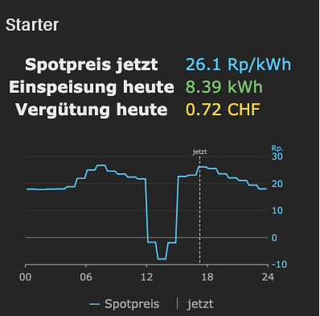
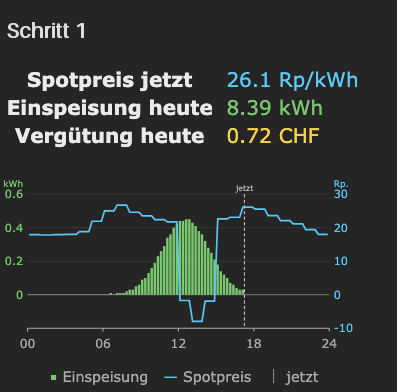
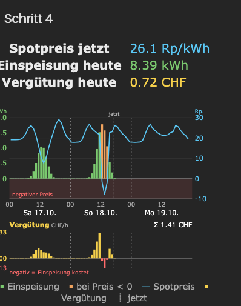

# Übungen – Arbeiten mit dem Coding-Agenten auf dem gPlug

📄 [Diese Übung als PDF (A4)](docs/EXERCISES.pdf) · [Begriffe: LEGENDE.md](LEGENDE.md)

Gegenstand der Übungen ist der **Arbeitszyklus mit dem Agenten**: Kontext geben → kleine,
prüfbare Aufgabe formulieren → Code aufs Gerät laden → Konsole lesen → Fehler wörtlich
zurückgeben. Die Berry-App `app/spot.be` ist nur das Übungsobjekt. Die Übungen ändern nur die
Darstellung, nie den Datenfluss; bei Fehlern bleibt der Kern der App intakt.

Die Seite ist zum Lesen **von oben nach unten** gebaut: Schritte 1 und 2 führen durch jeden
Handgriff und erklären das *Warum*. Schritte 3–5 setzen den Ablauf voraus und sind kurz.
Jeder Schritt lässt sich auf- und zuklappen (▸): 1 und 2 sind offen, 3–5 zu. Weitere
aufklappbare Zeilen enthalten Hintergrund, den du beim ersten Durchgang nicht brauchst.

Grundlagen: `AGENTS.md` (Regeln und Werkzeuge, liest der Agent automatisch), `TASMOTA_BERRY_API.md`
(die Tasmota-API, ohne die der Agent rät), `SETUP_OPENCODE.md` §7 (Arbeitsweise im Agenten).

## Farbcode: plan oder build

opencode hat zwei Agenten. Welcher aktiv ist, steht unten im Eingabefeld (`Plan` bzw. `Build`).
Umschalten mit **`Tab`** (oder `Shift+Tab`), jedes Drücken wechselt zum anderen Agenten. Der
Gesprächsverlauf bleibt beim Wechsel erhalten: der Build-Agent kennt den Plan. Der falsche Agent
ist der häufigste Fehler, darum sind die beiden auf dieser Seite farbig markiert:

> [!NOTE]
> **🔵 PLAN** – der Agent darf nur lesen: nichts ändern, nichts hochladen. Blau steht vor jedem
> Prompt «planen».

> [!TIP]
> **🟢 BUILD** – der Agent darf Dateien ändern und Befehle ausführen (nach deiner Freigabe). Grün
> steht vor den Prompts «umsetzen» und «Fehler zurückgeben».

> [!WARNING]
> **⚠️ Stolperstein** – was an dieser Stelle typischerweise schiefgeht und was du dann tust.

In den Schritten erkennst du die drei am Zeichen am Zeilenanfang: 🔵 PLAN, 🟢 BUILD, ⚠️.

Merkregel: **planen = plan, alles andere = build.** opencode startet im **build**-Agent.

## Überblick: vom Starter zur Referenz-App in 4 Schritten, dazu Schritt 5

Du erhältst im Docker-Container einen **Starter** (nur Preislinie) und baust die Grafik bis zum
Zielbild `docs/zielbild.jpg` aus. **Pflicht: Schritte 1 und 2. Schritte 3 und 4 für Schnelle.
Schritt 5 für Fortgeschrittene.** Zeitbudget im Übungsblock 45 min.

<details>
<summary>Alle Schritte im Überblick (Tabelle)</summary>

| Schritt | Ziel | Sichtbares Resultat | Lernziel KI |
|---|---|---|---|
| 0 Starter | – | Preislinie, 1 Tag, ¼ h | – |
| 1 Energie-Balken | Einspeisung pro ¼ h als grüne Balken, eigene kWh-Achse links | Solarkurve unter der Preislinie | Kontext geben: Erweiterungspunkt und Datenquelle nennen |
| 2 Negativpreis | Balken orange bei Preis < 0, Bereich unter 0 Rp. schattiert, Legende | Mittagstief fällt auf | Kleine, prüfbare Aufgabe; Testfall benennen (Sim: Mittagstief < 0) |
| 3 3 Tage, Stundenwerte | x-Achse 72 h, Tagesnamen, 00/12-Marken; Stunde = Mittel (Preis) bzw. Summe (Energie) | Do–Sa wie im Zielbild | Umbauen statt anbauen; Heap vorher/nachher messen |
| 4 Vergütungs-Chart | Zweites Chart darunter: CHF/h gelb/rot, Σ über 3 Tage | Zielbild komplett | Auf eigenem Ergebnis aufbauen; Wiederverwendung einfordern |
| 5 2 Tage, Viertelstunden | 192 ¼-h-Werte: gestern + heute, ab Preisen für morgen heute + morgen; Preis als Treppe | Preisspitzen innerhalb der Stunde sichtbar | Konstanten statt Zahlen; Kosten (Bytes, ms, Heap) messen lassen |

- Jeder Schritt ist in der WebUI sichtbar und für sich lauffähig. 1–2 ändern nur den einen Tag
  (klein, schnell), 3 ist der Umbau, 4 baut auf 3 auf, 5 auf 4 (ändert das Zielbild). Schritte
  1–2 gelingen auch, wenn 3 scheitert.
- **Checkpoints**: `app/steps/spot_1.be` … `spot_5.be` enthalten den fertigen Stand nach jedem
  Schritt, `spot_0.be` den Starter. Wer hängen bleibt, kopiert selbst den passenden Checkpoint
  nach `app/spot.be`; der Befehl steht am Ende jedes Schritts.

</details>

<details>
<summary>Starter (Schritt 0): was schon da ist</summary>



Daten vollständig, Darstellung minimal:

- Im Hintergrund: Preisabruf (F1), Zähler mit Simulator inkl. Zeitraffer, `Po` und gefüllten
  Vortagen (F2), Tages-CSV (F4), `SpotPrices` (F5). Der Speicher hält **3 Tage** Preise und Energie.
- Textzeilen über dem Chart: Spotpreis jetzt, Einspeisung heute, Vergütung heute. Damit sind die
  Daten sichtbar, bevor sie gezeichnet werden; Schritt 1 lässt sich an «Einspeisung heute» prüfen.
- Chart: **nur die Preislinie** (cyan, `COL_PRICE`), 1 Tag mit 96 ¼-h-Werten, Achse Rp./kWh
  rechts, Nulllinie, «jetzt»-Marke (grau), Legende aus `chart_curves()`. Farben wie im Zielbild;
  `COL_ENERGY` (grün), `COL_NEG` (orange), `COL_PAY` (gelb), `COL_COST` (rot) sind schon definiert.
- Simulator gibt dem heutigen Tag ein Mittagstief mit negativen Preisen (Testfall Schritt 2).
- Vorhandene Helfer: `chart_curves()`, `send_polyline(...)`, `value_range(...)`, `nice_range(...)`
  (runde Achsenstufen), `y_scale(...)`, `send_data_attr(...)` (Werte für den Cursor),
  Farbkonstanten `COL_...`, Datenzugriff `self.store.price(key, slot)` (1/10'000 CHF/kWh) und
  `self.store.energy_at(key, slot)` (0.01 kWh), beide `nil` = Lücke.
- Kommentare `# ERWEITERUNGSPUNKT Schritt 1` … `Schritt 4` am Anfang von `F3  Chart`; jeder
  Checkpoint enthält nur noch die Punkte der offenen Schritte.
- Cursor-Script in allen Stufen gleich: es zeigt jeden vorhandenen Wert (`data-p`, `data-e`,
  `data-v`) und rechnet die Zeit aus `data-m` (15 oder 60 min). Kein Schritt ändert das Script.

</details>

## Vorbereitung (5 min)

1. Geräte-IP prüfen (eingetragen im RUNBOOK, Schritt 6.1). Erwartet: die IP, z.B. `192.168.1.50`.
   ```sh
   cat .gplug
   ```
2. Gerät antwortet, erwartet JSON mit `"Sim":true`. **`HeapFree` notieren** (Ausgangswert, z.B. 125).
   ```sh
   ./brcmd.sh 'tasmota.cmd("SpotStatus")'
   ```
3. WebUI des gPlug im Browser offen lassen (`http://192.168.x.y`).
4. opencode starten:
   ```sh
   ./docker-run.sh
   ```
   Nur ohne Docker (nativ installiert, `SETUP_OPENCODE.md`), im Repo-Ordner:
   ```sh
   opencode
   ```

## Schritt 1 – Energie-Balken (Pflicht, ~20 min)

**Ziel:** Nach diesem Schritt zeigt die App neben dem Preis auch deine Einspeisung. In der WebUI
siehst du hinter der Preislinie grüne Balken (kWh pro Viertelstunde) mit eigener Achse links.

<details open>
<summary><b>Schritt 1 – Anleitung</b> (zuklappen, wenn erledigt)</summary>



<details>
<summary>Vorgaben im Detail (stehen auch im Prompt «planen»)</summary>

- Datenquelle `self.store.energy_at(key, slot)` (Einheit 0.01 kWh, `nil` = Lücke, kein Balken).
- Kurzbuchstabe `e` (SVG-Gruppe `se`), Farbe `COL_ENERGY` (grün).
- Achse **links** mit kWh-Werten von 0 bis Tagesmaximum, Beschriftung «kWh» oben links. Das ist
  die einzige neue Achse; die Preisachse rechts bleibt unverändert.
- Eintrag «Einspeisung» in der Legende mit Balkensymbol `&#9632;`, ein-/ausblendbar wie Spotpreis.
- Balken vor der Preislinie zeichnen (Linie liegt oben).
- Bestehende Helfer verwenden (`chart_curves`, `value_range`, `y_scale`). Keine neue Schleife über
  die Slots ausserhalb einer Methode `send_bars`, kein JavaScript, nichts anderes ändern.

</details>

### 1.1 Planen lassen

> **🔵 PLAN** – `Tab` drücken, bis unten `Plan` steht. Dann diesen Prompt einfügen und absenden.

```
Lies @AGENTS.md, @TASMOTA_BERRY_API.md und in @app/spot.be den Abschnitt "F3  Chart" mit dem
Kommentar "ERWEITERUNGSPUNKT Schritt 1".

Aufgabe: Im Tageschart soll die eingespeiste Energie pro Viertelstunde (kWh) als grüne Balken
hinter der Preislinie erscheinen.

Vorgaben: Datenquelle self.store.energy_at(key, slot) (0.01 kWh, nil = Lücke). Kurzbuchstabe e,
Farbe COL_ENERGY. Eine neue Achse links mit kWh von 0 bis Tagesmaximum (ausdrücklich erlaubt),
Preisachse rechts unverändert. Legendeneintrag "Einspeisung" mit &#9632;, ein-/ausblendbar.
Bestehende Helfer verwenden: chart_curves, value_range, y_scale. Kein JavaScript, nichts anderes
ändern.

Schreibe einen Plan: welche Methoden du änderst oder neu anlegst und wie du das Ergebnis prüfst
(Desktop-Harness, upload.sh, log.sh, Heap). Frag nach, wenn etwas unklar ist. Noch nichts ändern.
```

Plan lesen. Er ist gut, wenn er eine Methode `send_bars` anlegt, die Legende über
`chart_curves()` erweitert und die Prüfung (Harness, Upload, Log, Heap) nennt.

**Warum zuerst planen?** Im plan-Agent liest der Agent den Code, ohne ihn zu ändern. Einen
falschen Ansatz erkennst du in einer Minute Lesen; derselbe Fehler im Code kostet Upload, Log
und Rückbau. Der Prompt nennt Erweiterungspunkt und Datenquelle, weil der Agent sonst rät, wo
und womit er arbeiten soll.

> **⚠️ Plan ablehnen, wenn er eines davon enthält:**
>
> - **Eigene Zeichenschleife** ausserhalb von `send_bars` (der Agent kopiert gern die
>   Polyline-Logik).
> - **Checkboxen, `onchange` oder `<script>`** im Chart: funktionieren nie. Tasmota ersetzt den
>   Sensorbereich alle paar Sekunden per AJAX, Scripts darin laufen nicht.
> - **Weitere Achsen** ausser der einen kWh-Achse links.
> - **Funktionen, die nicht in `TASMOTA_BERRY_API.md` stehen** (z.B. `webserver.content_send`
>   in `web_sensor`): erfunden.
> - **Änderungen ausserhalb der Aufgabe** («bei der Gelegenheit …»).
>
> Im **plan**-Agent bleiben, Vorgabe zitieren, neuen Plan verlangen, z.B.: «Der Plan verletzt
> die Vorgabe "kein JavaScript". Neuer Plan, Legende nur über chart_curves().» Erst weiter, wenn
> der Plan stimmt.

### 1.2 Umsetzen lassen

> **🟢 BUILD** – `Tab` drücken, bis unten `Build` steht. Dann diesen Prompt einfügen und absenden.

```
Setze den Plan um, in dieser Reihenfolge:
1. Änderung in app/spot.be.
2. cd app && berry desktop_harness.be – muss mit HARNESS OK enden.
3. ./upload.sh app/spot.be, danach ./log.sh. Jede Zeile mit BRY: oder SPOT: wörtlich zeigen.
4. ./brcmd.sh 'tasmota.gc()' und ./brcmd.sh 'tasmota.memory("heap_free")', Heap melden.
Melde in fünf Zeilen: was geändert, was geprüft, was offen. Die WebUI prüfe ich selbst.
```

opencode fragt vor jedem Shell-Befehl. Einzeln freigeben, und nur diese: `./upload.sh`,
`./log.sh`, `./brcmd.sh`, `berry`, `cp`, `git`. Alles andere ablehnen und fragen, wozu.

**Warum diese Reihenfolge?** Der Desktop-Harness findet Syntaxfehler in Sekunden und ohne
Gerät. Erst was dort mit `HARNESS OK` endet, geht aufs Gerät. Die feste Reihenfolge im Prompt
verhindert, dass der Agent Prüfungen überspringt und trotzdem «fertig» meldet.

> **⚠️ Stolpersteine beim Umsetzen**
>
> - **Der Agent antwortet nur mit Text und ändert nichts:** es ist noch plan aktiv. Auf build
>   schalten, Prompt nochmals senden.
> - **Der Agent will etwas anderes hochladen** (`persist.be`, `path.be`, `webserver.be`,
>   `desktop_harness.be`): das sind Desktop-Stubs, `upload.sh` lehnt sie ab. Aufs Gerät gehört
>   nur `app/spot.be`.
> - **`BrRestart` / `Restart` über `brcmd.sh`** sind gesperrt (Absturz bzw. Reboot). App neu
>   laden nur über `./upload.sh`.

### 1.3 Log lesen, Fehler zurückgeben

Der Agent zeigt nach dem Upload die Ausgabe von `./log.sh`. Selbst lesen, nicht nur die
Zusammenfassung des Agenten:

- **`BRY:`** kommt vom Berry-Interpreter: Fehler beim Laden der App (Syntax, strict mode) oder
  eine Exception, meist mit Zeilennummer. Die App läuft dann nicht oder noch im alten Stand.
- **`SPOT:`** schreibt die App selbst: ein Callback hat einen Fehler abgefangen, z.B.
  `SPOT: web_sensor …` oder `SPOT: page_svg …` mit der Fehlermeldung dahinter.
- Keine Fehlermeldung mit `BRY:` oder `SPOT:`: die App ist geladen. Weiter bei 1.4.

Bei einem Fehler:

> **🟢 BUILD** – nicht umschalten. Fehlerzeilen kopieren und mit diesem Prompt zurückgeben.

```
./log.sh zeigt nach dem Upload:
<Zeilen wörtlich einfügen>
Behebe nur diesen Fehler, lade neu hoch und lies das Log erneut.
```

**Warum nach jedem Upload das Log?** `upload.sh` meldet `OK`, sobald die Datei auf dem Gerät
liegt. Ob Berry sie laden konnte, steht nur im Log. **Warum wörtlich?** Meldung und Zeilennummer
führen den Agenten direkt zur Stelle; aus einer Umschreibung («geht nicht») rät er.

> **⚠️ Stolpersteine im Log**
>
> - **`BRY:`-Fehler mit Zeilennummer direkt beim Laden:** oft ein fehlendes `var` für eine neue
>   Instanzvariable (strict mode). Zeile wörtlich an den Agenten.
> - **Unbekannte Funktion:** erfundene API. Auf `TASMOTA_BERRY_API.md` verweisen; nur dort
>   Genanntes gilt.
> - **Zweimal derselbe Fehler:** anhalten, Log selbst lesen, Kursleitung fragen oder Checkpoint
>   nehmen (Ende des Schritts). Mehr Versuche kosten nur Heap.

### 1.4 Resultat prüfen

Zuerst am Gerät, dann im Browser:

```sh
./brcmd.sh 'tasmota.cmd("SpotStatus")'            # Days vorhanden, HeapFree nahe Ausgangswert
./brcmd.sh 'tasmota.gc()'; ./brcmd.sh 'tasmota.memory("heap_free")'   # soll > 100 kB bleiben
git diff --stat                                   # nur app/spot.be geändert
```

Im Browser: Seite **neu laden** (Cmd+R / F5), Kurven per Legende aus- und einblenden, mit der
Maus Werte anfahren. Erwartet:

- Grüne Balken mit Tageskurve (Simulator: Maximum um 12:40, Sockel 0.3 kW = 0.075 kWh/¼ h).
- Achse links in kWh, Preisachse rechts unverändert, Legende mit «Einspeisung».
- Summe der Balken ≈ «Einspeisung heute» in der Kopfzeile.
- `app/sensor.html` (Harness) enthält `<g id='se'>`.

**Warum den Heap prüfen?** Der gPlug hat nur ~110 kB freies RAM. Ein Leck sieht man nicht beim
ersten Laden, sondern erst nach mehreren. Jeder Upload kostet ~1 kB, den erst ein Neustart
zurückgibt; unter 100 kB startet `upload.sh` das Gerät selbst neu. Fällt der Wert stärker als
das, ist die Änderung schuld.

> **⚠️ Das Resultat des Agenten kann falsch sein, auch wenn alles «OK» meldet.**
> `HARNESS OK`, ein sauberes Log und ein Chart mit grünen Balken beweisen nur, dass der Code
> läuft, **nicht, dass er richtig rechnet**. Der Agent sagt «fertig» genauso überzeugt, wenn die
> Werte falsch sind.
>
> Typisches Beispiel: **falsche Skala.**
>
> - Balken mit der Preis-Skala statt mit eigener kWh-Skala gezeichnet: 0.075 kWh auf einer Achse
>   von 0–15 Rp. ergibt Balken von 1–2 Pixel, das Chart sieht «fast leer» aus.
> - Achse links in Rohwerten (0.01 kWh) beschriftet: oben steht «30» statt «0.30» kWh.
> - Achse links beschriftet, Balken aber mit anderem Maximum skaliert: Balkenhöhe passt nicht zur
>   Zahl auf der Achse.
>
> **Selbst nachrechnen, nicht dem Agenten glauben:** Höchster Balken = Zahl oben an der kWh-Achse?
> Sockel ≈ 0.075 kWh? Summe ≈ «Einspeisung heute»? Preislinie unverändert wie vorher? Stimmt eine
> Zahl nicht: Fehler mit konkreten Werten an den Agenten zurückgeben (🟢 BUILD).

> **⚠️ Chart oder Cursor fehlt nach dem Upload:** Seite neu laden, kein Fehler im Code. Die
> Seite läuft noch mit dem alten Script (Tasmota ersetzt per AJAX nur den Sensorbereich, das
> Script lädt nur beim Seitenaufruf). Das Chart kommt vom Handler `/spot.svg` (`page_svg`). Will
> der Agent es zurück in `web_sensor` holen: nein (kostete 1.2 s pro Refresh, Gerät stürzte ab).

### 1.5 Stand sichern

```sh
cp app/spot.be spot_schritt1.be
```

Wer git kennt, stattdessen: `git add app/spot.be && git commit -m "Schritt 1"`.

**Warum sichern?** Schritt 2 baut auf diesem Stand auf. Geht dort etwas schief, kommst du mit
einem `cp` zurück, statt den Agenten reparieren zu lassen. Die Sicherung zeigt später auch per
`diff`, was der Agent wirklich geändert hat.

Hängen geblieben? Fertigen Stand von Schritt 1 holen und bei Schritt 2 weitermachen:

```sh
cp app/steps/spot_1.be app/spot.be && ./upload.sh app/spot.be
```

</details>

## Schritt 2 – Negativpreis hervorheben (Pflicht, ~15 min)

**Ziel:** Nach diesem Schritt zeigt die App, wann Einspeisen Geld kostet. In der WebUI sind die
Balken orange, wo der Preis unter 0 liegt, und der Bereich unter 0 Rp. ist schattiert.

<details open>
<summary><b>Schritt 2 – Anleitung</b> (zuklappen, wenn erledigt)</summary>


<details>
<summary>Vorgaben im Detail (stehen auch im Prompt «planen»)</summary>

- Farbe `COL_NEG` (orange) für Balken mit `self.store.price(key, slot) < 0`, sonst `COL_ENERGY`.
- Schattierung: ein Rechteck von der Nulllinie bis zum unteren Rand, halbtransparent, hinter allem,
  mit Text «negativer Preis». Nur zeichnen, wenn der Tag negative Preise hat (die Preisachse
  reicht dann unter 0).
- Legendeneintrag «Einspeisung bei Preis < 0» in Orange.
- Testfall: Im Sim-Modus hat der heutige Tag ein Mittagstief mit negativen Preisen (Preislinie
  im Chart unter 0).

</details>

### 2.1 Planen lassen

> **🔵 PLAN** – zurück auf plan: `Tab` drücken, bis unten `Plan` steht. Prompt einfügen, absenden.

```
Lies in @app/spot.be den Abschnitt "F3  Chart" mit dem Kommentar "ERWEITERUNGSPUNKT Schritt 2".

Aufgabe: Energie-Balken in Slots mit negativem Preis orange (COL_NEG) statt grün. Bereich unter
der Nulllinie halbtransparent schattieren mit Text "negativer Preis", nur wenn der Tag negative
Preise hat. Legendeneintrag "Einspeisung bei Preis < 0" in Orange.

Nichts anderes ändern. Nenne im Plan, wie du prüfst, dass orange Balken genau bei negativem
Preis erscheinen (der Simulator liefert heute ein Mittagstief < 0). Noch nichts ändern.
```

Plan lesen. Er ist gut, wenn er die Farbe in `send_bars` pro Slot wählt, die Legende über
`chart_curves()` erweitert und einen Test für «orange genau bei Preis < 0» nennt.

**Warum ein Testfall im Prompt?** «Mach es orange» kann der Agent nicht prüfen, «orange genau
dort, wo der Preis < 0 ist, der Simulator liefert das heute Mittag» schon. Eine kleine Aufgabe
mit benanntem Testfall ergibt einen Plan, den du in einer Minute beurteilen kannst.

> **⚠️ Plan ablehnen, wenn er eines davon enthält:**
>
> - **Zweite Balken-Methode oder eigene Schleife** für die orangen Balken statt einer Farbwahl
>   in `send_bars`.
> - **Checkboxen, `onchange`, `<script>`** oder **weitere Achsen**.
> - **Prüfung über `SpotPrices`:** zeigt nur die nächsten 10 h, am Abend ist das Mittagstief
>   vorbei. Geprüft wird am Chart bzw. im Harness.
> - **Änderungen ausserhalb der Aufgabe.**
>
> Im **plan**-Agent bleiben, Vorgabe zitieren, neuen Plan verlangen.

### 2.2 Umsetzen lassen

> **🟢 BUILD** – `Tab` drücken, bis unten `Build` steht. Gleicher Prompt wie in Schritt 1.

```
Setze den Plan um, in dieser Reihenfolge:
1. Änderung in app/spot.be.
2. cd app && berry desktop_harness.be – muss mit HARNESS OK enden.
3. ./upload.sh app/spot.be, danach ./log.sh. Jede Zeile mit BRY: oder SPOT: wörtlich zeigen.
4. ./brcmd.sh 'tasmota.gc()' und ./brcmd.sh 'tasmota.memory("heap_free")', Heap melden.
Melde in fünf Zeilen: was geändert, was geprüft, was offen. Die WebUI prüfe ich selbst.
```

Shell-Befehle einzeln freigeben, nur `./upload.sh`, `./log.sh`, `./brcmd.sh`, `berry`, `cp`,
`git`.

**Warum derselbe Prompt?** Der Ablauf ändert sich nicht, nur die Aufgabe. Ein fester
Umsetz-Prompt macht die Meldungen des Agenten vergleichbar: du siehst sofort, wenn eine Prüfung
fehlt.

> **⚠️ Scope-Creep** («bei der Gelegenheit habe ich auch …»): «nichts anderes ändern»
> wiederholen, Änderung mit `/undo` zurücknehmen. Antwortet der Agent nur mit Text: noch plan
> aktiv, auf build schalten.

### 2.3 Log lesen, Fehler zurückgeben

`./log.sh` selbst lesen: `BRY:` = Berry konnte die App nicht laden oder ausführen
(Zeilennummer!), `SPOT:` = die App hat in einem Callback einen Fehler abgefangen. Keine solche
Fehlermeldung: weiter bei 2.4. Sonst:

> **🟢 BUILD** – nicht umschalten. Fehlerzeilen wörtlich zurückgeben.

```
./log.sh zeigt nach dem Upload:
<Zeilen wörtlich einfügen>
Behebe nur diesen Fehler, lade neu hoch und lies das Log erneut.
```

**Warum «nur diesen Fehler»?** Ohne die Einschränkung baut der Agent bei der Fehlersuche gern
weiteres um. Dann weisst du nicht mehr, welche Änderung den Fehler behoben oder einen neuen
gebracht hat.

> **⚠️ Zweimal derselbe Fehler:** anhalten, Log selbst lesen. Zurück zum gesicherten Stand mit
> `cp spot_schritt1.be app/spot.be`, dann Schritt 2 mit genauerem Prompt neu planen.

### 2.4 Resultat prüfen

```sh
./brcmd.sh 'tasmota.cmd("SpotStatus")'            # Days vorhanden, HeapFree nahe Ausgangswert
./brcmd.sh 'tasmota.gc()'; ./brcmd.sh 'tasmota.memory("heap_free")'   # soll > 100 kB bleiben
diff spot_schritt1.be app/spot.be | head -40      # wenige Stellen (oder git diff --stat)
```

Im Browser: Seite **neu laden**. Erwartet:

- Orange Balken genau dort, wo die Preislinie unter 0 liegt (Sim: Mittagstief).
- Schattierung mit Text «negativer Preis» unter der Nulllinie; ohne negative Preise sähe das
  Chart aus wie nach Schritt 1.
- Legende mit «Einspeisung bei Preis < 0» in Orange; Balken und Preislinie sonst wie vorher.

**Warum der `diff`?** Er zeigt, was der Agent wirklich geändert hat, unabhängig von seiner
Meldung. Für diesen Schritt sind es wenige Stellen in `F3  Chart`. Viel mehr heisst: der Agent
hat mehr umgebaut als verlangt.

> **⚠️ Auch hier selbst nachsehen:** Liegt jeder orange Balken unter einem Stück Preislinie
> < 0, und kein grüner? Balkenhöhen gleich wie nach Schritt 1 (nur die Farbe ändert)? Chart
> fehlt nach dem Upload: Seite neu laden.

### 2.5 Stand sichern

```sh
cp app/spot.be spot_schritt2.be
```

Mit git: `git add app/spot.be && git commit -m "Schritt 2"`.

**Warum jetzt?** Schritt 3 baut das Chart um. Das ist der Schritt, bei dem am meisten
schiefgeht, und dieser Stand ist dein Rückweg.

Hängen geblieben? `cp app/steps/spot_2.be app/spot.be && ./upload.sh app/spot.be`

</details>

**Pflichtteil geschafft.** Den Ablauf kennst du jetzt: 🔵 planen → Plan prüfen → 🟢 umsetzen →
Log lesen → Heap und WebUI prüfen → sichern. Die Schritte 3–5 nennen nur noch, was neu ist.

## Schritt 3 – 3 Tage mit Stundenwerten (für Schnelle, ~20 min)

**Ziel:** Nach diesem Schritt zeigt die App den ganzen Speicher statt nur heute. In der WebUI
siehst du 3 Tage nebeneinander mit Stundenwerten und Tagesnamen («Do 11.06.»).

<details>
<summary><b>Schritt 3 – Anleitung aufklappen</b></summary>


Das Chart zeigt **die 3 Tage im Speicher** (Ringpuffer, ältester links; ab ~17 Uhr ist der
jüngste Tag morgen) **mit Stundenwerten** statt einem Tag mit Viertelstunden. Vorgaben:

- 72 Werte. Stundenwert: Preis = **Mittel**, Energie = **Summe** der 4 Viertelstunden. Fehlen
  alle 4 Werte: Lücke. Stundenwerte **einmal pro Aufruf** von `page_svg` (Handler `/spot.svg`) rechnen
  (`fill_hours(start)` in feste `bytes`-Puffer), Kurven lesen sie mit `hour_p(i)`/`hour_e(i)`.
  Grund: 72 × 4 Store-Zugriffe pro Kurve überschreiten sonst die 50-ms-Grenze.
- x-Achse: Tagesgrenzen gestrichelt, Marken 00 und 12, Tagesname mit Datum unter jedem Tag
  («Do 11.06.»).
- «jetzt»-Marke an der richtigen Stunde über alle 3 Tage.
- Orange-Regel aus Schritt 2 gilt pro Stunde (Stundenpreis < 0).
- Bestehende Methoden umbauen, nicht kopieren: `value_range`, `send_polyline`, `send_bars`,
  `send_x_axis` bekommen den Bereich (Starttag, Anzahl Werte) als Parameter.
- **Heap**: vor und nach der Änderung `tasmota.gc()` + `heap_free` messen, Differenz melden.
  Mehr als 5 kB Einbruch beim Rendern: anhalten.

> **🔵 PLAN** – `Tab` bis unten `Plan` steht, Prompt einfügen. Plan prüfen: jede geänderte
> Methode aufgelistet, keine Kopien, Heap-Messung vorher/nachher.

```
Lies in @app/spot.be den Abschnitt "F3  Chart" mit dem Kommentar "ERWEITERUNGSPUNKT Schritt 3".

Aufgabe: Das Chart zeigt 3 Tage mit 72 Stundenwerten statt einem Tag mit 96 Viertelstunden.
Stundenwert: Preis = Mittel, Energie = Summe der 4 Viertelstunden, Lücke wenn alle 4 fehlen.
Stundenwerte einmal pro page_svg-Aufruf in feste bytes-Puffer rechnen (fill_hours), nicht pro Kurve.
x-Achse mit gestrichelten Tagesgrenzen, Marken 00 und 12, Tagesname mit Datum ("Do 11.06.").
"jetzt"-Marke über alle 3 Tage richtig. Orange-Regel aus Schritt 2 pro Stunde.

Baue die bestehenden Methoden um (Bereich als Parameter), kopiere sie nicht. Miss den Heap vor
und nach der Änderung (tasmota.gc(), dann heap_free). Liste im Plan jede Methode auf, die du
änderst, und warum. Noch nichts ändern.
```

> **🟢 BUILD** – `Tab` bis unten `Build` steht, dann wie in Schritt 1–2: Prompt «umsetzen» →
> `./log.sh` lesen, Fehler wörtlich zurück → Heap und WebUI prüfen → sichern mit
> `cp app/spot.be spot_schritt3.be`.

<details>
<summary>Prompts «umsetzen» und «Fehler zurückgeben», Prüfbefehle</summary>

```
Setze den Plan um, in dieser Reihenfolge:
1. Änderung in app/spot.be.
2. cd app && berry desktop_harness.be – muss mit HARNESS OK enden.
3. ./upload.sh app/spot.be, danach ./log.sh. Jede Zeile mit BRY: oder SPOT: wörtlich zeigen.
4. ./brcmd.sh 'tasmota.gc()' und ./brcmd.sh 'tasmota.memory("heap_free")', Heap melden.
Melde in fünf Zeilen: was geändert, was geprüft, was offen. Die WebUI prüfe ich selbst.
```

```
./log.sh zeigt nach dem Upload:
<Zeilen wörtlich einfügen>
Behebe nur diesen Fehler, lade neu hoch und lies das Log erneut.
```

```sh
./brcmd.sh 'tasmota.cmd("SpotStatus")'            # Days vorhanden, HeapFree nahe Ausgangswert
./brcmd.sh 'tasmota.gc()'; ./brcmd.sh 'tasmota.memory("heap_free")'
diff spot_schritt2.be app/spot.be | head -40      # oder git diff --stat
```

</details>

**Erwartetes Resultat:** 3 Tage nebeneinander, Tagesnamen, 72 Balken, Preislinie in Stundenstufen.

<details>
<summary>Resultat im Detail, Stolpersteine, Checkpoint</summary>

- Vergleich mit der Sicherung des vorherigen Schritts: Umbau in bestehenden Methoden, keine
  kopierten `send_..._3d`-Varianten.
- Heap nach Upload und `tasmota.gc()` höchstens ~2 kB unter dem Wert vor dem Schritt.
- ⚠️ **Kopieren statt umbauen:** `send_x_axis_3d`, `value_range2` usw. Prompt: «Bau die
  bestehende Methode um, lösche die Kopie.»
- ⚠️ **Stundenwerte pro Kurve gerechnet** statt einmal in `fill_hours`: Rendern wird langsam
  (50-ms-Grenze). Vorgabe zitieren.
- Hängen geblieben? `cp app/steps/spot_3.be app/spot.be && ./upload.sh app/spot.be`

</details>

</details>

## Schritt 4 – Vergütungs-Chart (für Schnelle, ~15 min)

**Ziel:** Nach diesem Schritt zeigt die App, was die Einspeisung einbringt. In der WebUI steht
unter dem Chart ein zweites, flaches Chart «Vergütung CHF/h» mit der Summe Σ über die 3 Tage.
Damit ist das Zielbild erreicht.

<details>
<summary><b>Schritt 4 – Anleitung aufklappen</b></summary>



Unter dem bestehenden Chart ein **zweites, flaches Chart: Vergütung pro Stunde (CHF)**, gleiche
x-Achse, mit **Summe Σ über die 3 Tage** oben rechts. Vorgaben:

- Vergütung pro Stunde = Summe über die 4 Viertelstunden von Preis × Energie. In `fill_hours` aus
  Schritt 3 mitrechnen (dritter Puffer, `hour_v(i)`), nicht neu schleifen.
- Balken gelb (`COL_PAY`) bei ≥ 0, rot (`COL_COST`) bei < 0. Nulllinie, Achse links mit Max/0/Min
  in CHF. Text «negativ = Einspeisung kostet» unten links, nur wenn es negative Werte gibt.
- Titel «Vergütung CHF/h» links, «Σ x.xx CHF» rechts.
- Gleiche x-Positionen wie oben (Stunde n liegt in beiden Charts übereinander), «jetzt»-Marke auch
  unten.
- Stückweise senden wie das obere Chart (`tasmota.web_send` pro Teil), kein Gesamtstring.

> **🔵 PLAN** – `Tab` bis unten `Plan` steht, Prompt einfügen. Plan prüfen: nennt er, was er
> wiederverwendet (`fill_hours`, Zeichenmethoden) und was neu ist?

```
Lies in @app/spot.be den Abschnitt "F3  Chart" mit dem Kommentar "ERWEITERUNGSPUNKT Schritt 4".

Aufgabe: Unter dem Chart ein zweites, flaches Chart "Vergütung CHF/h": pro Stunde Summe aus
Preis × Energie der 4 Viertelstunden, Balken gelb (COL_PAY) bei >= 0, rot (COL_COST) bei < 0,
Achse links in CHF, Summe "Σ x.xx CHF" oben rechts über die 3 Tage. Gleiche x-Positionen wie
oben, "jetzt"-Marke auch unten.

Verwende die Stundenwert-Hilfsmethode aus Schritt 3 und die bestehenden Zeichenmethoden weiter.
Sende stückweise mit tasmota.web_send. Nenne im Plan, welche Methoden du wiederverwendest und
welche neu sind. Noch nichts ändern.
```

> **🟢 BUILD** – `Tab` bis unten `Build` steht, dann wie in Schritt 1–2: Prompt «umsetzen» →
> `./log.sh` lesen, Fehler wörtlich zurück → Heap und WebUI prüfen → sichern mit
> `cp app/spot.be spot_schritt4.be`.

<details>
<summary>Prompts «umsetzen» und «Fehler zurückgeben», Prüfbefehle</summary>

```
Setze den Plan um, in dieser Reihenfolge:
1. Änderung in app/spot.be.
2. cd app && berry desktop_harness.be – muss mit HARNESS OK enden.
3. ./upload.sh app/spot.be, danach ./log.sh. Jede Zeile mit BRY: oder SPOT: wörtlich zeigen.
4. ./brcmd.sh 'tasmota.gc()' und ./brcmd.sh 'tasmota.memory("heap_free")', Heap melden.
Melde in fünf Zeilen: was geändert, was geprüft, was offen. Die WebUI prüfe ich selbst.
```

```
./log.sh zeigt nach dem Upload:
<Zeilen wörtlich einfügen>
Behebe nur diesen Fehler, lade neu hoch und lies das Log erneut.
```

```sh
./brcmd.sh 'tasmota.cmd("SpotStatus")'            # Days vorhanden, HeapFree nahe Ausgangswert
./brcmd.sh 'tasmota.gc()'; ./brcmd.sh 'tasmota.memory("heap_free")'
diff spot_schritt3.be app/spot.be | head -40      # oder git diff --stat
```

</details>

**Erwartetes Resultat:** Zielbild `docs/zielbild.jpg` erreicht: zwei Charts, Stunden übereinander.

<details>
<summary>Resultat im Detail, Stolpersteine, Checkpoint</summary>

- Σ stimmt mit der Summe der Tageswerte überein (Kopfzeile «Vergütung heute» + Vortage).
- Heap nach Upload und `tasmota.gc()` > 100 kB, Rendering ohne Einbruch > 5 kB.
- ⚠️ **Neue Schleife über die Viertelstunden** für die Vergütung statt Mitrechnen in
  `fill_hours`: ablehnen.
- ⚠️ **Kopierte Zeichenmethoden** fürs zweite Chart (`send_bars2`, `send_x_axis_pay`): «Bau die
  bestehende Methode um, lösche die Kopie.»
- ⚠️ **Weitere Achsen:** erlaubt ist hier nur die CHF-Achse links im neuen Chart.
- Hängen geblieben? `cp app/steps/spot_4.be app/spot.be && ./upload.sh app/spot.be`

</details>

</details>

## Schritt 5 – 2 Tage mit Viertelstunden (für Fortgeschrittene, ~25 min)

**Ziel:** Nach diesem Schritt zeigt die App die Preise so fein, wie BKW sie publiziert. In der
WebUI siehst du in beiden Charts 2 Tage mit je 96 Viertelstunden, der Preis als Treppe.

Voraussetzung: Schritt 4 fertig, sonst `cp app/steps/spot_4.be app/spot.be && ./upload.sh app/spot.be`.

<details>
<summary><b>Schritt 5 – Anleitung aufklappen</b></summary>

<details>
<summary>Zielbild, Hintergrund und Vorgaben</summary>


Hintergrund: BKW publiziert inzwischen **verschiedene Preise pro Viertelstunde** (z.B.
16 Uhr: 32.8 / 34.4 / 46.5 / 48.9 Rp.). Das Stundenmittel aus Schritt 3
glättet die Spitzen weg (Mittel 40.6 Rp.). Die Daten im Speicher sind schon Viertelstunden, nur
die Darstellung fasst zusammen.

Beide Charts zeigen **2 Tage mit je 96 Viertelstunden** (192 Werte) statt 3 Tage mit
Stundenwerten. Vorgaben:

- Tage: **gestern (Verlauf) + heute**; sobald Preise für morgen da sind (BKW ab ca. 17 Uhr),
  **heute + morgen**. In `chart_start`.
- Neue Konstanten `CH_DAYS = 2` und `CH_Q = 1` (Viertelstunden pro Wert), dazu `CH_N = 192`,
  `CH_MIN = 15`. Keine 2, 96, 192 oder 24 mehr als Zahl im Chart-Code. Prüfung: mit `CH_DAYS = 3`,
  `CH_Q = 4`, `CH_N = 72`, `CH_MIN = 60` muss wieder das Chart aus Schritt 4 erscheinen.
- `fill_hours` umbauen (umbenennen in `fill_values`, `hour_*` in `val_*`): `CH_Q` Viertelstunden pro Wert;
  Preis = Mittel, Energie und Vergütung = Summe wie bisher.
- Preis als **Treppenlinie**: jeder Wert waagrecht über seine ganze Breite (`send_polyline`
  umbauen, keine zweite Zeichenmethode).
- `send_bars` sendet einen Pfad, sobald er `PATH_MAX` (600) Byte lang ist, und beginnt einen neuen.
  Grund: 192 Balken ergäben ~3 kB pro Pfad-String.
- x-Achse pro Tag: Marken 00/06/12/18, Tagesname; `data-d` mit einem Eintrag pro Tag. Unteres
  Chart: «Vergütung CHF/¼h».
- **Kosten messen und melden**: Grösse von `/spot.svg` im Desktop-Harness (`SVG … bytes`),
  Laufzeit von `fill_values` auf dem Gerät, Heap vor/nach. Grenzen: SVG < 16 kB, Heap > 100 kB.

</details>

> **🔵 PLAN** – `Tab` bis unten `Plan` steht, Prompt einfügen. Plan prüfen: jede geänderte
> Methode genannt, Konstanten statt Zahlen, Messung von SVG-Grösse, Laufzeit und Heap.

```
Lies in @app/spot.be den Abschnitt "F3  Chart" mit dem Kommentar "ERWEITERUNGSPUNKT Schritt 5".

Aufgabe: Beide Charts zeigen 2 Tage mit je 96 Viertelstunden (192 Werte) statt 3 Tage mit
Stundenwerten. Tage: gestern + heute; sobald Preise für morgen da sind, heute + morgen (chart_start).
Neue Konstanten CH_DAYS = 2 und CH_Q = 1 (Viertelstunden pro Wert), CH_N = 192, CH_MIN = 15; keine
dieser Zahlen fest im Chart-Code. fill_hours wird fill_values und rechnet CH_Q Viertelstunden pro Wert.
Preis als Treppenlinie (jeder Wert waagrecht über seine Breite) in send_polyline. send_bars sendet
Pfade ab 600 Byte in Stücken. x-Achse pro Tag 00/06/12/18, data-d pro Tag, unten "CHF/¼h".

Baue die bestehenden Methoden um, kopiere sie nicht. Nenne im Plan jede geänderte Methode und
wie du SVG-Grösse (Desktop-Harness), Laufzeit von fill_values (tasmota.millis() mit brcmd.sh) und
Heap misst. Noch nichts ändern.
```

> **🟢 BUILD** – `Tab` bis unten `Build` steht, dann wie in Schritt 1–2: Prompt «umsetzen» →
> `./log.sh` lesen, Fehler wörtlich zurück → Heap und WebUI prüfen → sichern mit
> `cp app/spot.be spot_schritt5.be`.

<details>
<summary>Prompts «umsetzen» und «Fehler zurückgeben», Prüfbefehle</summary>

```
Setze den Plan um, in dieser Reihenfolge:
1. Änderung in app/spot.be.
2. cd app && berry desktop_harness.be – muss mit HARNESS OK enden.
3. ./upload.sh app/spot.be, danach ./log.sh. Jede Zeile mit BRY: oder SPOT: wörtlich zeigen.
4. ./brcmd.sh 'tasmota.gc()' und ./brcmd.sh 'tasmota.memory("heap_free")', Heap melden.
Melde in fünf Zeilen: was geändert, was geprüft, was offen. Die WebUI prüfe ich selbst.
```

```
./log.sh zeigt nach dem Upload:
<Zeilen wörtlich einfügen>
Behebe nur diesen Fehler, lade neu hoch und lies das Log erneut.
```

```sh
./brcmd.sh 'tasmota.cmd("SpotStatus")'            # Days vorhanden, HeapFree nahe Ausgangswert
./brcmd.sh 'tasmota.gc()'; ./brcmd.sh 'tasmota.memory("heap_free")'
diff spot_schritt4.be app/spot.be | head -40      # oder git diff --stat
```

</details>

**Erwartetes Resultat:** 2 Tage nebeneinander, 192 schmale Balken, Preis als Treppe mit ¼-h-Stufen.

<details>
<summary>Resultat im Detail, Stolpersteine, Checkpoint</summary>

- Mit echten BKW-Preisen sind die Spitzen innerhalb einer Stunde sichtbar (Vergleich:
  Grafana/BKW-Kurve).
- Vor 17 Uhr gestern + heute, «jetzt» im rechten Tag; danach heute + morgen, «jetzt» im linken Tag.
- Cursor zeigt Tag und Uhrzeit auf die Viertelstunde (`data-m` = 15).
- Referenzwerte (`spot_5.be`): Harness `SVG … bytes = 12204` (Schritt 4: 7010), `fill_values` 57 ms
  auf dem C3, Heap 111 kB stabil nach mehrfachem Rendern.
- ⚠️ **Zahlen statt Konstanten** bleiben im Chart-Code stehen: Gegenprobe mit `CH_DAYS = 3`,
  `CH_Q = 4`, `CH_N = 72`, `CH_MIN = 60` verlangen.
- ⚠️ **Zweite Zeichenmethode** für die Treppe statt Umbau von `send_polyline`: ablehnen.
- ⚠️ **Agent meldet keine Messwerte:** nachfragen. Ohne Bytes, ms und Heap ist der Schritt
  nicht fertig.
- Fertiger Stand zum Vergleich: `app/steps/spot_5.be`.

</details>

</details>

## Bonus (wer fertig ist)

<details>
<summary>Zwei Ideen: CSV mit Stundenwerten, Schwellwert an Shelly/MQTT</summary>

- **CSV mit Stundenwerten**: zusätzlich zur Tageszeile `spot_h_YYYY-MM.csv`, Aufbewahrung zwei
  Monate. Erweiterungspunkt `cfg["csv_hourly"]` und `day_end()`. Lehrt: Testbarkeit einfordern
  (Funktion mit Datums-Parameter verlangen).
- **Schwellwert an Shelly/MQTT**: bei Preis unter/über Schwelle ein HTTP-schaltbares Gerät
  schalten oder per `mqtt.publish` melden. Erweiterungspunkt `json_append()` / neuer Command. Lehrt:
  Drittsystem-API als Kontext geben (Shelly-Doku-Auszug), sonst rät der Agent.

</details>

## Checkliste Abschlussrunde

- Der Prompt, der funktioniert hat (wörtlich).
- Der Prompt, der schiefging, und was der Agent daraus gemacht hat.
- Anzahl Upload-Zyklen und erreichter Schritt.
- `HeapFree` am Anfang und am Ende.
