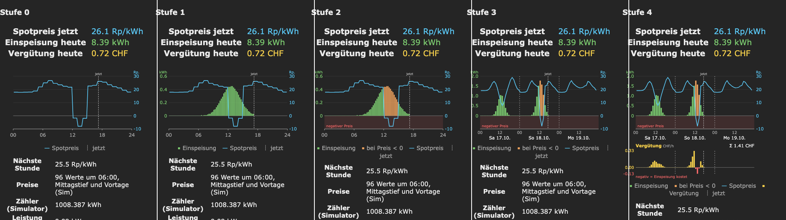

# gPlug Spotpreis-App (Tasmota Berry)



*Vom Starter (links, nur Spotpreis) zur Referenz-App (rechts): Einspeisung, Negativpreise, 3 Tage,
Vergütung. Am Workshop baust du diese Schritte mit dem Coding-Agenten.*

Unterlagen für den DIY-Workshop **«Arbeiten mit einem Coding-Agenten auf einem Embedded-Gerät»**.
Stand der Unterlagen: Datei `VERSION`. Die Berry-App für den [gPlug](https://gplug.ch) holt die
dynamischen BKW-Einspeisetarife, misst die eingespeiste Energie und zeigt beides als Chart in der
Tasmota-WebUI.

## Programm

Ablauf pro Durchführung im Ordner [`workshop-instances/`](workshop-instances/):

- [Do 14.01.2027, 17:00–20:00](workshop-instances/2027-01-14.md)

## Mitbringen

Eigener gPlug ([gplug.ch](https://gplug.ch)), Notebook (Windows, macOS oder Linux) mit Netzteil,
USB-Datenkabel. Installiert: [Docker Desktop](https://docs.docker.com/get-started/get-docker/)
(Linux auch Docker Engine) und ein Texteditor. Sonst keine Vorbereitung nötig.

## Einführung

Folien zur Einführung: <https://gplug-ch.github.io/ki-workshop/slides/>

## Vor Ort einrichten (40 min)

Ein Runbook pro System, Schritt für Schritt mit erwarteter Ausgabe. Übersicht:
[`RUNBOOK.md`](RUNBOOK.md).

| Notebook | Runbook | Terminal |
|---|---|---|
| Windows | [`RUNBOOK_WINDOWS.md`](RUNBOOK_WINDOWS.md) | Ubuntu in WSL (empfohlen) oder PowerShell |
| macOS | [`RUNBOOK_MACOS.md`](RUNBOOK_MACOS.md) | Terminal |
| Linux | [`RUNBOOK_LINUX.md`](RUNBOOK_LINUX.md) | beliebig; Einfügen mit Ctrl+Shift+V |

Danach läuft der Agent opencode im Docker-Container (Zugang zum Sprachmodell eingebaut, gilt nur
am Workshop-Tag), der gPlug ist im Workshop-WLAN und zeigt den Starter: die Preislinie eines Tages
(Simulator, kein Smart Meter nötig).

## Übung (65 min)

Ablauf, Prompts und Prüfschritte: [`EXERCISES.md`](EXERCISES.md) ([PDF, A4](docs/EXERCISES.pdf)).

| Teil | Schritt | Für wen |
|---|---|---|
| A, von Hand | 0 Hello World: `app/hello.be` über die WebUI hochladen und starten (vor dem Starter, Runbook Schritt 6) | alle |
| B, mit opencode | 0 Hello World: vom Ein-Satz-Prompt zum vollständigen Prompt, der Agent schreibt `app/hello_agent.be` | alle |
| | 1 Energie-Balken mit kWh-Achse | Pflicht |
| | 2 Negativpreis: Balken orange, Bereich unter 0 schattiert | Pflicht |
| | 3 3 Tage mit Stundenwerten | optional, für Schnelle |
| | 4 Vergütungs-Chart mit Σ | optional, für Schnelle |
| | 5 2 Tage mit Viertelstunden | optional, für Fortgeschrittene |

Hängen geblieben: Checkpoint des vorigen Schritts `app/steps/spot_N.be` nach `app/spot.be`
kopieren.

## Nach dem Workshop

- gPlug zurück ins Heim-WLAN, am Smart Meter Simulator ausschalten: Runbook deines Systems,
  Abschnitt *Nach dem Workshop*.
- Weiterarbeiten mit eigenem Zugang zum Sprachmodell: [`SETUP_OPENCODE.md`](SETUP_OPENCODE.md).
- Weiterarbeiten ohne KI, nur mit Texteditor und Upload von Hand:
  [`SETUP_OHNE_KI.md`](SETUP_OHNE_KI.md).

<!-- kursleitung -->
## Nur Kursleitung (nicht im Teilnehmer-Repo)

### Funktionen (Referenz-App)

- **Preise**: BKW-API `dyntariffs/v1/Tariffs/energyreturn`, 96 Viertelstundenwerte pro Tag,
  stündlich geprüft, nur bei Bedarf abgerufen. ~21 kB JSON wird sofort nach dem Parsen freigegeben.
- **Zähler**: Export-Zählerstand aus dem gPlug-Script (`z.Eo`), alle 15 min, Delta auf 0.01 kWh.
  Ohne Smart Meter läuft ein Simulator (`sim: true`) mit Leistung `Po`, Zeitraffer (`sim_tick`
  5/15/60 min) und gefüllten Vortagen; der heutige Tag bekommt ein Mittagstief mit Negativpreisen.
- **WebUI**: Kopfzeilen (Preis jetzt, Einspeisung heute, Vergütung heute) + SVG-Chart über 3 Tage
  mit Stundenwerten (Einspeisung, Spotpreis, Vergütung), Cursor mit Werten, oberhalb des
  Tasmota-Hauptmenüs. Der Starter (`app/spot.be`) zeigt nur die Preislinie eines Tages.
- **CSV**: eine Zeile pro Tag in `spot_YYYY-MM.csv` (`Datum;Energie_kWh;Verguetung_CHF`),
  maximal zwei Monatsdateien.
- **Commands**: `SpotPrices` (nächste 10 h als JSON), `SpotPrices 15`, `SpotStatus`,
  `SpotFetch`, `SpotFetch file`, `SpotTick`.
- **Telemetrie**: `"Spot":{"Price","EnergyToday","RevenueToday"}` im Tele-JSON, im Sim-Modus
  zusätzlich `"Po"`.

Speicher: 4 Tage × 100 Slots × 2 Byte je für Preis und Energie, ca. 1.6 kB RAM. Freier Heap
mit geladener App ~110 kB.

### Installation ohne Skripte

Voraussetzungen: Tasmota ≥ 15.3.0 mit Berry, UFS und SML (gPlug ab Webshop), `Timezone 99`
(Sommerzeit; ab Werk steht `+01:00`).

```sh
H=http://<gplug-ip>
curl -s -o /dev/null $H/ufsd                 # einmal nach jedem Neustart: Upload-Modus Datei
curl -F 'ufsu=@app/spot.be'     $H/ufsu
curl -F 'ufsu=@app/autoexec.be' $H/ufsu
curl "$H/cm?cmnd=BrRestart"                  # lädt autoexec.be -> load("spot")
curl "$H/cm?cmnd=SpotStatus"
```

Alternativ über die Tasmota-WebUI: *Werkzeuge → Dateisystem verwalten*, dann in der Konsole
`BrRestart`. Existiert auf dem Gerät schon eine `autoexec.be`: dort `load("spot")` ergänzen.
Konfiguration am Anfang von `app/spot.be` (`spot_cfg`): `sim`, `meter_path`, `days`,
`csv_dir`, `csv_hourly`.

### Entwicklung

- `app/spot.be` – Starter, `# ERWEITERUNGSPUNKT` markiert die Übungsschritte; neue Chart-Kurven
  über `chart_curves()` und `send_polyline` / `send_bars` (Abschnitt `F3  Chart`).
- `app/steps/spot_1.be` … `spot_4.be` – Checkpoints; `spot_4.be` = Referenz-App. `spot_5.be` – Schritt 5
  für Fortgeschrittene (2 Tage, Viertelstunden), baut auf `spot_4.be` auf.
- `app/steps/hello_agent.be` – Musterlösung Schritt 0 mit opencode (Teil B).
- `RUNBOOK_WINDOWS.md`, `RUNBOOK_MACOS.md`, `RUNBOOK_LINUX.md` – Schritte 2 und 4–6 sind in allen
  drei gleich; Änderungen dort in allen dreien nachführen.
- `tools/build_tapp.sh` – `app/steps/spot_4.be` als `dist/spot.tapp` (Smart Meter) und
  `dist/spot-sim.tapp` (Simulator) packen.
- `tools/make_steps.py` – erzeugt Starter und Checkpoints 1–3 aus `spot_4.be` (ohne Option nur
  prüfen, `--write` schreibt). Nach Änderungen alle Stände mit dem Harness prüfen.
- `app/desktop_harness.be` – simuliert einen Tag auf dem PC (`berry`, braucht `bkw.json`), endet
  mit `HARNESS OK`. `app/persist.be`, `app/path.be` – Stubs nur dafür.
- `reference/` – `read_sensors`-Samples (gPlug L+G E450, Kamstrup).
- `docs/build-pdf.sh` – `EXERCISES.md` als A4-PDF (pandoc + Chrome).
- `Dockerfile`, `docker-run.sh`, `docker-run.ps1` – Sandbox (opencode 2.0, `berry`, `git`, nur
  dieser Ordner sichtbar).
- `TASMOTA_BERRY_API.md`, `INTENT.md` – Kontext für den Agenten: API-Spickzettel, Anforderungen.
- `THIRD_PARTY.md` – fremde Inhalte und Lizenzen.

Neuladen ohne Neustart: `Br load("spot")` (idempotent).

### Interne Unterlagen

- `WORKSHOP_PREP.md` – Zeitplan, KI-Didaktik, Setup vor Ort, Deliverables, Risiken.
- `DOCKER_ADMIN.md`, `Dockerfile.workshop`, `tools/publish-image.sh`, `tools/delete-image.sh` –
  Workshop-Image mit Key auf ghcr.io veröffentlichen und danach löschen.
- `261021-meeting/` – Meeting 21.10.
- `mock/` – UI-Mock mit synthetischen Daten, `ui-drafts/` – die drei UI-Entwürfe.
- `tools/sync_participant.sh` – überträgt den Stand ins Teilnehmer-Repo `gplug-ch/ki-workshop`.
- `VERSION` – Version der Unterlagen (SemVer). Vor jedem Sync oder Image-Push anheben, als
  `git tag v$(cat VERSION)` markieren; landet im Image als Label und `$WORKSHOP_VERSION`.
  Dieselbe Version steht in allen Ständen `app/spot.be`, `app/steps/spot_*.be` (Titelzeile und
  Log `SPOT: v… geladen`); `tools/make_steps.py` meldet eine Abweichung.
  Push des Tags baut das GitHub-Release mit den tapp-Dateien (`.github/workflows/release-tapp.yml`).
<!-- /kursleitung -->

## Lizenz

MIT, siehe `LICENSE`.
